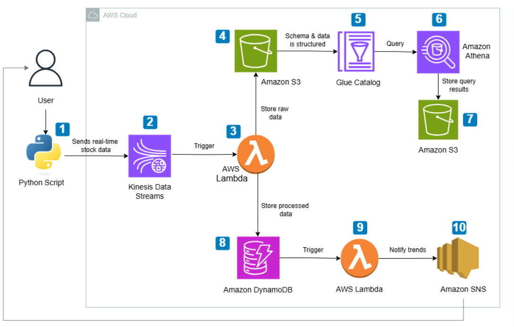

# Lyft Real-Time Stock Analytics Pipeline on AWS

  

A serverless pipeline that tracks Lyft (NASDAQ: LYFT) stock data in near real time. Price and volume records are streamed into AWS, stored for both fast lookups and historical analysis, checked for unusual price moves, and queried with SQL.

**Services**: Kinesis, Lambda, DynamoDB, S3, Glue Data Catalog, Athena, SNS, IAM, CloudWatch

## Architecture

## Analysis

The stored LYFT data is analyzed with Athena SQL across these areas:

1. Data quality: record counts, nulls, duplicates, valid price ranges, timestamp gaps and schema checks
2. Price movement: daily high, low and range, and how the price compares with the previous close
3. Anomaly detection: records where LYFT moved more than a set percentage from the previous close
4. Volume: unusually high-volume days and which hours of the trading day are most active
5. Trends: moving averages and the largest price changes between consecutive records.

